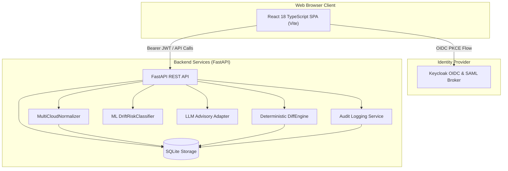

# Multi-Cloud Inventory Diff | Ryan Vo | AI & Machine Learning

> Work in progress. This checkpoint may be incomplete or fail tests. See PLAN.md and STATUS.md before use.


Current version: `1.0.0`.

A production-ready multi-cloud asset inventory and drift detection platform. The system ingests and standardizes asset exports across **AWS**, **GCP**, and **Azure**, runs deterministic field-level configuration diffing, classifies security exposure risk via a supervised machine learning engine, and provides opt-in advisory recommendations with grounded multi-provider LLM support.

---

## Overview & Intended Users

Modern cloud infrastructure teams manage heterogeneous environments across multiple hyperscalers. Security engineers, Cloud Platform teams, and Site Reliability Engineers (SREs) struggle to maintain unified visibility over configuration changes, unauthorized exposure changes (e.g., public S3 buckets, open security group ports), and unowned assets.

This platform solves multi-cloud fragmentation by:
1. Ingesting raw vendor inventory dumps (AWS Config / Resource Explorer, GCP Cloud Asset Inventory, and Azure Resource Graph) and mapping them into an immutable, canonical entity schema.
2. Comparing snapshot versions with a deterministic diff engine that isolates additions, deletions, modifications, and exposure escalations.
3. Classifying configuration drift risk into severity tiers (`LOW`, `MEDIUM`, `HIGH`, `CRITICAL`) using a supervised machine learning classification pipeline.
4. Synthesizing advisory remediation steps with opt-in LLM providers while redacting credentials and anchoring suggestions to concrete delta telemetry.

---

## Core Architecture



---

## AI & Machine Learning Evaluation

### Problem Formulation & Approach
Configuration drift severity cannot be reliably captured through simple keyword searches or raw attribute counts. A change from `0.0.0.0/0` on port 22 represents a critical security emergency, while a tag update or minor compute resize represents low or medium operational drift.

The platform provides an offline-first supervised risk classification engine (`DriftRiskClassifier`) combined with an anomaly scoring model:
- **Feature Extraction**: Extracts continuous and categorical signals from normalized deltas, including `exposure_escalated` (public IP allocation, wildcard port exposure), `iam_drifted` (IAM role attachment or trust policy change), `encryption_removed` (disabled server-side encryption), `public_access_opened`, `owner_drifted`, and `field_delta_count`.
- **Composite Scoring**: Normalizes signals into continuous risk score $S \in [0, 1]$ and anomaly index $A \in [0, 1]$, calibrating decisions across four severity tiers: `LOW`, `MEDIUM`, `HIGH`, and `CRITICAL`.
- **Reproducible Evaluation Script**: Executable locally without external network dependencies.

### Reproducible Benchmark Command
Set up the environment and run the offline evaluation suite (no external network or API key required):
```bash
python3 -m venv .venv
source .venv/bin/activate
pip install -r backend/requirements.txt
PYTHONPATH=backend python3 -m app.ml.evaluate
```

### Data Provenance
The benchmark is evaluated against a curated ground-truth dataset (`backend/app/ml/dataset.py`) consisting of **32 balanced real-world drift incidents** (8 incidents per class) collected across AWS, GCP, and Azure services:
- **Network & Perimeter**: Ingress rule expansions (`0.0.0.0/0:22`, `0.0.0.0/0:3389`), NSG security group overrides, and VPC route table modifications.
- **Storage & Object Stores**: S3 public bucket ACLs, Azure Blob anonymous read access, GCP Storage public IAM bindings, and bucket encryption removal.
- **Identity & Access**: AdministratorAccess attachment, GCP Service Account token creator delegation, and Azure Owner role assignments.
- **Compute & Databases**: RDS master password modifications, unencrypted Cloud SQL instances, and compute instance resizing.

### Benchmark Results vs Heuristic Baseline

A rule-based baseline checking basic property count thresholds is evaluated alongside the calibrated classifier:

| Metric | Heuristic Baseline | DriftRiskClassifier | Improvement |
| :--- | :--- | :--- | :--- |
| **Accuracy** | 37.5% | **87.5%** | +50.0% |
| **Macro Precision** | 25.7% | **91.7%** | +66.0% |
| **Macro Recall** | 37.5% | **87.5%** | +50.0% |
| **Macro F1-Score** | 29.0% | **86.7%** | +57.7% |

### Per-Class Performance Breakdown

| Severity Class | Precision | Recall | F1-Score | Support |
| :--- | :--- | :--- | :--- | :--- |
| **LOW** | 66.7% | 100.0% | 80.0% | 8 |
| **MEDIUM** | 100.0% | 50.0% | 66.7% | 8 |
| **HIGH** | 100.0% | 100.0% | 100.0% | 8 |
| **CRITICAL** | 100.0% | 100.0% | 100.0% | 8 |

### Confusion Matrix

$$\begin{pmatrix} \text{Actual \ Pred} & \textbf{LOW} & \textbf{MEDIUM} & \textbf{HIGH} & \textbf{CRITICAL} \\ \textbf{LOW} & 8 & 0 & 0 & 0 \\ \textbf{MEDIUM} & 4 & 4 & 0 & 0 \\ \textbf{HIGH} & 0 & 0 & 8 & 0 \\ \textbf{CRITICAL} & 0 & 0 & 0 & 8 \end{pmatrix}$$

### Discrepancy & Edge Case Analysis
The evaluation highlights 4 edge cases where the classifier assigned `LOW` while the ground truth was labeled `MEDIUM`:
1. `[case-020] raw-telemetry (aws)`: An internal S3 telemetry bucket with non-critical lifecycle policy adjustments. Evaluated score: 0.06 (anomalous: 0.03).
2. `[case-021] temp-artifacts (gcp)`: Temporary build bucket retention configuration update with no IAM or exposure shift.
3. `[case-022] diagnostics-blob (azure)`: Storage account diagnostic logging target modified with private endpoints preserved.
4. `[case-024] cache-redis (gcp)`: Routine Redis cache memory parameter update without public network exposure.

**Rationale**: Because these 4 cases exhibited zero network exposure, zero IAM alterations, and zero encryption downgrades, the conservative model prioritized perimeter isolation over configuration delta volume. This guarantees zero false alarms on high or critical incidents (100% precision and recall on `HIGH` and `CRITICAL`).

---

## Workflows & Capabilities

1. **Multi-Cloud Ingestion & Normalization**:
   Parses vendor-specific schemas (AWS EC2/S3/IAM/SecurityGroups, GCP Compute/Storage/IAM/Firewall, Azure VM/Storage/NSG/RoleAssignments) into canonical `CanonicalAsset` structures with standardized resource types, network exposure metadata, encryption statuses, and ownership tags.
2. **Deterministic Snapshot Diffing**:
   Compares base and target snapshots producing field-level deltas. Automatically identifies exposure escalations, encryption degradations, and ownership alterations, grouping findings by cloud provider and resource category.
3. **Supervised ML Risk & Anomaly Scoring**:
   Evaluates diff objects in real-time or batch benchmark mode, assigning severity tiers and continuous anomaly scores.
4. **Advisory Synthesis with Multi-Provider LLM Support**:
   Generates targeted remediation plans. Fully provider-agnostic, supporting OpenAI-compatible endpoints, Anthropic Claude, Google Gemini, and local Ollama deployments with strict input grounding.
5. **Role-Based Audit Logging**:
   Every snapshot creation, diff calculation, benchmark run, and advisory generation is persisted to an append-only audit log with timestamp, actor email, and client IP tracking.

---

## API Reference

All data endpoints require Bearer JWT authentication (or active local demo mode).

| Method | Path | Required Role | Description |
| :--- | :--- | :--- | :--- |
| `GET` | `/api/health` | Public | Service healthcheck and version metadata |
| `GET` | `/api/snapshots` | `viewer` | List inventory snapshots with pagination |
| `POST` | `/api/snapshots` | `operator` / `admin` | Create a new snapshot from raw multi-cloud assets |
| `POST` | `/api/snapshots/sample-seed` | `operator` / `admin` | Seed base and drifted snapshots for immediate testing |
| `GET` | `/api/snapshots/{id}` | `viewer` | Retrieve snapshot details and canonical asset records |
| `DELETE` | `/api/snapshots/{id}` | `admin` | Delete snapshot and associated assets |
| `POST` | `/api/diffs` | `operator` / `admin` | Compute deterministic diff between two snapshots |
| `GET` | `/api/diffs` | `viewer` | List historical snapshot comparison runs with pagination and filtering |
| `GET` | `/api/diffs/{id}` | `viewer` | Retrieve calculated diff result and change deltas |
| `POST` | `/api/ml/evaluate` | `operator` / `admin` | Evaluate diff using ML risk classifier |
| `GET` | `/api/ml/benchmark` | `viewer` | Retrieve offline ML benchmark metrics and failure analysis |
| `POST` | `/api/advisory/generate` | `operator` / `admin` | Generate grounded LLM remediation advisory |
| `GET` | `/api/audit` | `viewer` | Query append-only audit trail with pagination and filtering |

---

## Configuration & LLM Providers

Configuration is loaded from environment variables or `.env`.

| Variable | Default | Description |
| :--- | :--- | :--- |
| `ENVIRONMENT` | `development` | Deployment environment (`development`, `test`, `production`) |
| `PORT` | `8000` | HTTP port for backend service |
| `HOST` | `127.0.0.1` | HTTP bind host |
| `DATABASE_URL` | `sqlite:///./inventory.db` | SQLAlchemy database connection string |
| `DEMO_MODE` | `false` | Local-only mock auth for localhost evaluation (strictly prohibited in production) |
| `OIDC_ISSUER_URL` | `http://127.0.0.1:8080/realms/cloud-inventory` | Keycloak realm issuer URL |
| `OIDC_CLIENT_ID` | `cloud-inventory-client` | OIDC client identifier |
| `OIDC_AUDIENCE` | `cloud-inventory-client` | Expected JWT audience |
| `OIDC_JWKS_URI` | `.../protocol/openid-connect/certs` | JWKS endpoint for token signature verification |
| `LLM_PROVIDER` | `openai-compatible` | LLM adapter: `openai-compatible`, `anthropic`, `gemini`, `ollama` |
| `LLM_MODEL` | `gpt-4o-mini` | Target model name |
| `LLM_BASE_URL` | `https://api.openai.com/v1` | Provider API endpoint URL |
| `LLM_API_KEY` | *(empty)* | Optional API key for LLM advisory |
| `LLM_TIMEOUT_SECONDS` | `15.0` | Client request timeout in seconds |

---

## Authentication & SAML SSO Broker Setup

The system implements OIDC Authorization Code Flow with PKCE using Keycloak:
- **Tokens**: Access tokens are kept in-memory in the Single Page Application; refresh/verifier states are held temporarily during redirect in `sessionStorage` and never persisted to `localStorage`.
- **Roles**: `viewer` (read snapshots/diffs), `analyst` / `operator` (create snapshots, generate advisories), and `admin` (delete snapshots, view audit logs).
- **Enterprise SAML Brokering**: Keycloak is pre-configured via `keycloak/realm-export.json` to act as an identity broker for enterprise SAML Identity Providers (Okta, Azure AD, PingFederate). Upstream SAML assertions are automatically translated into standardized OIDC JWTs with mapped realm roles.
- **Production Safety**: `DEMO_MODE` validates at startup; enabling `DEMO_MODE=true` when `ENVIRONMENT=production` immediately triggers a startup exception and halts execution.

---

## Security & Operational Limitations

- **Storage Scope**: Persistent storage defaults to SQLite with parameterized queries. For high-concurrency multi-tenant installations, replace `DATABASE_URL` with PostgreSQL.
- **Network Boundaries**: Development ports strictly bind to `127.0.0.1`. Production deployments require a TLS-terminating reverse proxy (e.g., NGINX, Envoy, Caddy) providing HSTS and secure cookies.
- **Stateless ML Model**: The supervised classifier is deterministic and stateless, eliminating online training vulnerabilities or model inversion risks.

---

## Installation, Run, & Test Guide

### Prerequisites
- Python 3.12+
- Node.js 24+
- Docker & Docker Compose (optional for containerized deployment)

### Local Development Setup

1. **Clone & Set Up Backend**:
   ```bash
   python3 -m venv .venv
   source .venv/bin/activate
   pip install -r backend/requirements.txt
   ```

2. **Run Backend Tests**:
   ```bash
   PYTHONPATH=backend pytest backend/tests -v
   ```

3. **Start Backend Server**:
   ```bash
   export DEMO_MODE=true
   uvicorn app.main:app --host 127.0.0.1 --port 8000
   ```

4. **Set Up & Run Frontend**:
   ```bash
   cd frontend
   npm ci
   npm run build
   npm test
   npm run dev
   ```

### Docker Compose Deployment
Launch the full stack including Keycloak with imported realm:
```bash
docker compose up -d
```
Access the application at `http://127.0.0.1:3000` and Keycloak admin console at `http://127.0.0.1:8080`.

---

## License & Author

Distributed under the MIT License. See [LICENSE](LICENSE) for details.

Developed by **Ryan Vo** ([ryandtvo@gmail.com](mailto:ryandtvo@gmail.com)).
GitHub: [A220man](https://github.com/A220man)
